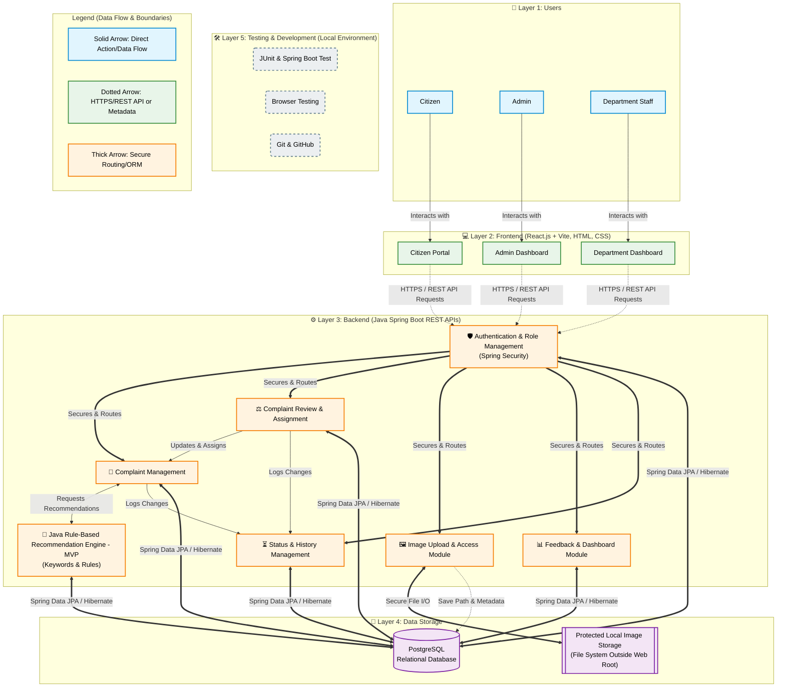
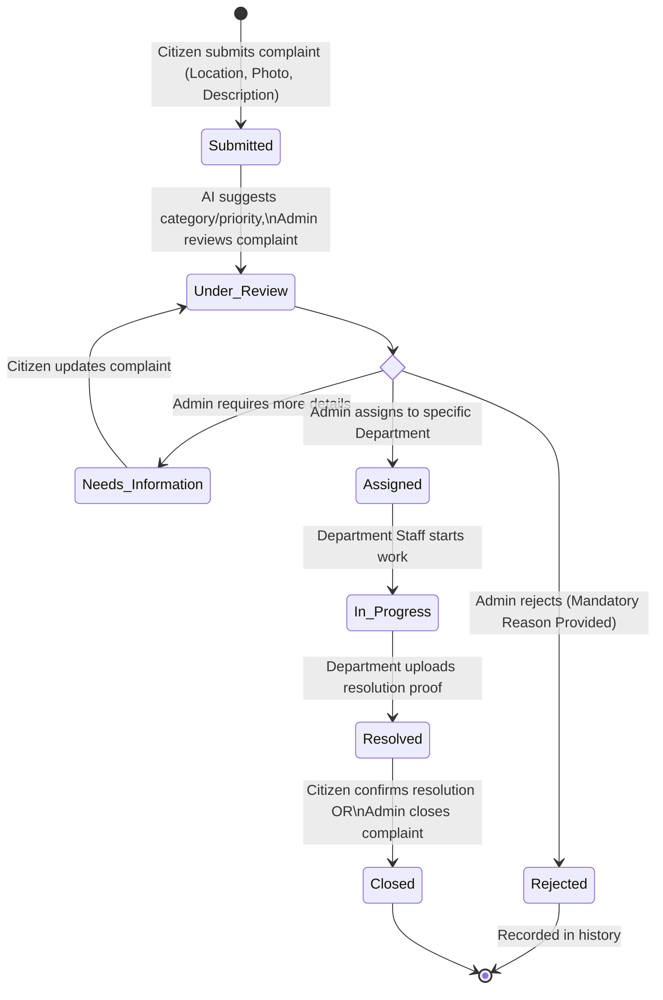

# CivicEye AI: System Architecture Design

## 1. Main System Architecture Diagram

## 2. Complaint Workflow Diagram

## 3. Explanation of Architecture Layers

### Layer 1: Users
This layer represents the three primary actors interacting with the system. **Citizens** report issues and track their status. **Admins** oversee the system, review incoming complaints, validate AI recommendations, and assign work. **Department Staff** receive assigned complaints, update progress, and provide evidence of resolution.

### Layer 2: Frontend
Built with **React.js + Vite, HTML, and CSS**, this layer serves the graphical user interfaces. It is logically divided into three distinct portals (Citizen Portal, Admin Dashboard, and Department Dashboard) to ensure a clean separation of concerns and user experiences. The frontend communicates entirely via stateless REST API calls to the backend, enabling secure local development and potential future cloud deployment.

### Layer 3: Backend (Java Spring Boot)
The core logic resides in a monolithic **Java Spring Boot** application, separated into functional modules. 
- **Authentication & Role Management** (via Spring Security) acts as a gateway, intercepting all API calls to verify identity and strict role permissions.
- The **Complaint Management** and **Review & Assignment** modules handle the business rules around creating, updating, and directing complaints.
- The **Status & History Management** module ensures an immutable audit trail of every state change and actor.
- The **Java Rule-Based Recommendation Engine (MVP)** uses keyword mapping and documented rules to suggest categories, priorities, and departments (no trained ML models).
- The **Image Upload & Access Module** ensures files are sanitized, validated, and securely handled without exposing direct URLs.

### Layer 4: Data Storage
The persistent data layer is split based on data type. **PostgreSQL** securely stores structured, relational data (Users, Roles, Complaints, Assignments, History, AI rules, and file paths) via Spring Data JPA and Hibernate. A **Protected Local Image Storage** (a secured directory on the host server's filesystem, completely isolated from the web root) holds the actual binary image uploads, requiring all retrieval to pass through the backend's access control module.

### Layer 5: Testing and Development
These are the supporting tools ensuring code quality and rapid iteration during local development. **JUnit and Spring Boot Test** provide unit and integration testing frameworks, **Browser Testing** validates the frontend UI, and **Git/GitHub** acts as the version control system.

## 4. Security Requirements (Architectural Enforcement)

- **Role-Based Access Control (RBAC):** Enforced strictly at Layer 3 (Spring Security), ensuring Citizens only fetch their own IDs, Admins manage all, and Department Staff only view assigned records. Frontend hiding is treated as UX, not security.
- **Data Protection:** Passwords are mathematically hashed (e.g., via BCrypt) before reaching the database. Plaintext passwords are never logged or stored.
- **Secure File Handling:** Uploaded images bypass public directories. The backend verifies file signatures (magic bytes), renames files randomly, and enforces max sizes. Image retrieval requires an authenticated session and verified authorization for the specific complaint.
- **Audit Trails:** The `StatusHist` module ensures mandatory logging of Admin rejections (including the reason) and status state transitions, preventing silent data deletion or hidden changes.

## 5. Main Data Flow (End-to-End Request Lifecycle)

1. **Citizen logs in** via the Citizen Portal; the portal receives an authenticated session token.
2. The Citizen **submits a complaint** (data + photo). React sends this payload via `HTTPS/REST API` to the backend.
3. **Spring Security** verifies the session token and confirms the "Citizen" role.
4. The Backend validates input. If a photo is attached, the `Image Upload Module` validates its safe format, generates a random name, saves it to **Protected Local Storage**, and passes the path back.
5. The backend saves the complaint data (with image metadata) in **PostgreSQL**.
6. The **Java Rule-Based Engine** scans keywords to suggest a category, severity, and department.
7. An **Admin logs in**, reviews the complaint in the Admin Dashboard, and can accept or override AI suggestions.
8. The Admin either **rejects** the complaint (adding a mandatory reason saved to PostgreSQL) or **assigns** it to a department.
9. **Department Staff** log in, see the assigned task, begin work (updating status), and ultimately upload resolution proof.
10. The **Citizen views** the final Resolved status and leaves feedback.
